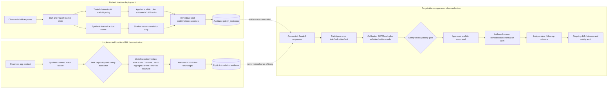

# Component 4 ML research pipeline

This implementation keeps the reviewed Skills 1–4 curriculum and deterministic
scaffolds as the production safety layer. Machine learning adds a second,
auditable decision-support layer; it does not generate Sinhala content or bypass
the authored remediation/confirmation state machine.

## Runtime flow

1. Flutter sends stable item/option IDs, attempts, timing, touch points, and the
   screen's supported scaffold actions to API port `8015`.
2. The gateway creates server-controlled provenance, builds a rolling
   current-session behavioral context, and accepts C3 probabilities only when
   they are explicitly observed and validated.
3. C4 on port `9017` updates BKT/IRT only from the first independent response.
4. On an incorrect ATTEMPT, the deterministic capability policy creates a
   baseline action from a copied state.
5. The action-outcome model scores only actions supported by that screen. A
   small instructional-cost penalty prefers replay/retry over answer-revealing
   help when their predicted benefit is similar.
6. In `shadow` mode the baseline is applied. In explicit
   `simulation_model` mode, the model recommendation is translated to stable,
   authored command/option IDs and applied. The translator protects targets,
   preserves two visible options, and safely falls back to retry when a model
   command cannot be rendered.
7. Each later response closes an **immediate (proximal) outcome** for the most
   recent scaffold. When the independent V2 equivalent confirmation is
   completed, its first-attempt result is linked to every scaffold in that
   support chain. The scaffolded click itself is never labelled as proof of
   learning; abandoned chains remain unlinked/censored.
8. Parent and specialist dashboards read the same stored evidence. The parent
   dashboard shows the latest session **for each attempted activity** across
   Skills 1–4 and counts distinct sessions rather than database rows. Starting
   a new activity therefore does not hide earlier completed activities. Parents get
   plain summaries; specialists get candidate scores, applied-vs-recommended
   action, immediate and confirmation outcomes, BKT/IRT state, C3 pipeline
   status, provenance, and limitations.

If C3 lacks its required matched speech, kinematic, demographic, or provenance
inputs, it is explicitly reported as `skipped_missing_inputs`. Missing child
measurements are not filled with synthetic values and synthetic-only C3 output
cannot control C4.

## Policy modes

- `baseline`: deterministic policy only.
- `shadow` (default): the model ranks alternatives and stores evidence while
  the deterministic policy controls the game.
- `simulation_model`: the included synthetic-trained model controls scaffold
  choice for a clearly labelled functional demonstration. Raw child events
  remain `observed`; the policy evidence separately says
  `execution_source=synthetic_model_simulation`. This is not efficacy evidence.
- `simulation_experiment`: stable SHA-256 50/50 assignment by learner/session
  to baseline rules or model simulation. Assignment probability and arm are
  stored for reproducible baseline-versus-model analysis.
- `model`: control is allowed only for a registered
  `pilot_approved`/`validated_observed` artifact.

Set the mode on the **API gateway (port 8015)** because it is the service that
creates the server-controlled C4 request. C4 on port 9017 may also use the
variable as a default for direct research requests:

```bash
export C4_POLICY_MODE=simulation_model
python main.py
```

Check the gateway is forwarding the intended mode:

```bash
curl http://127.0.0.1:8015/health
# c4_policy_mode_forwarded should be simulation_model

curl http://127.0.0.1:9017/health
# shows the model version, validation status and accepted policy modes
```

Run the read-only offline acceptance check to see four different task-family
decisions and their exact rendered commands:

```bash
cd app/backend/adaptive-tutoring-v1
source venv/bin/activate
python research/verify_component4_system.py
```

## Scaffold action space

The candidate set is built per task. Unsupported actions cannot be selected.

| Task capability | Executed support |
|---|---|
| `REMOVE_OPTION` | Remove one known distractor and reflow the answer pool |
| `DISABLE_OPTION` | Lock a distractor in place for spatial-memory tasks |
| `HIGHLIGHT_OPTION` | Guide attention to the correct target |
| `HIGHLIGHT_DESTINATION` | Glow the correct sorting destination |
| `REPLAY_INSTRUCTION` | Replay the exact current prompt |
| `SLOW_AUDIO` | Replay at 0.78× speed after replay/hesitation evidence; it has its own fitted action model |
| `REVEAL_FIRST_TOKEN` | Reveal the next unresolved sequence token |
| `SHOW_WORKED_EXAMPLE` | After repeated sorting errors, animate a different non-scored example into its category without revealing the live answer |

Correct-prefix locking is a deterministic safety invariant in sequence tasks,
not an ML treatment. Once the child has built a correct prefix, the UI keeps it
fixed and the model may support only the next unresolved token. Similarly,
fatigue never makes the model terminate a Grade-1 task: a one-minute optional
calm-break card is shown only after the activity is safely completed.

Every applied action, model score, utility, assignment arm, fallback, command,
immediate next response and independent confirmation outcome is stored.

## Data separation

Every research row uses `data_origin`, `dataset_id`, `validation_status`, and
`calibration_eligible`. Synthetic/public-external rows are always
calibration-ineligible. Newly collected app rows are also ineligible until
reviewed.

## Reproduce the synthetic action model

Run from the repository root. The API environment is used because it already
contains scikit-learn; C4 runtime reads plain JSON and does not need it.

```bash
app/backend/api/venv/bin/python \
  app/backend/adaptive-tutoring-v1/research/generate_synthetic_action_data.py \
  --output /tmp/c4_synthetic_action_data.csv \
  --learners 600 --interactions 24 --seed 26031

app/backend/api/venv/bin/python \
  app/backend/adaptive-tutoring-v1/research/train_action_model.py \
  --input /tmp/c4_synthetic_action_data.csv \
  --output app/backend/adaptive-tutoring-v1/models/c4_action_outcome_v1.json \
  --seed 26031
```

The trainer compares a class-prior baseline, logistic regression, random
forest, and histogram gradient boosting on a learner-group held-out split. It
also estimates policy value with self-normalized inverse propensity weighting.
All resulting claims remain labelled simulation evidence.

## Public-data adapter

The adapter accepts a locally obtained ASSISTments/EdNet-style CSV:

```bash
python app/backend/adaptive-tutoring-v1/research/import_public_kt.py \
  --input /path/to/public.csv \
  --output /tmp/public_kt_normalized.csv \
  --dataset-id assistments-release-id \
  --source-name ASSISTments
```

Public skills/items remain external-domain benchmark identifiers. They are not
renamed as Sinhala knowledge components and cannot calibrate the Sipsara bank.

## Near-real-time simulation

With C4 running on `9017`:

```bash
python app/backend/adaptive-tutoring-v1/research/replay_near_realtime.py \
  --input /tmp/c4_synthetic_action_data.csv --limit 20 --interval 0.25
```

## Observed-data calibration gate

After consent, data-quality review, participant-level splitting, and sufficient
coverage, preview approval:

```bash
python app/backend/adaptive-tutoring-v1/research/approve_observed_cohort.py \
  --dataset-id live-cohort-id --approved-by reviewer-name
```

Only after reviewing the dry-run count should `--apply` be added. Then run
`calibrate_item_bank.py` without `--apply`; apply calibration only if the
predeclared evidence requirements are met.

Run a read-only database integrity audit at any time:

```bash
python app/backend/adaptive-tutoring-v1/research/audit_research_database.py
```

For policy rows collected before action-outcome linkage was introduced, preview
an evidence-only repair and then explicitly apply it. The utility links only
stored later responses and stored V2 confirmations; it does not fabricate rows:

```bash
python app/backend/adaptive-tutoring-v1/research/backfill_policy_outcomes.py \
  --student-id STUDENT_ID --session-id SESSION_ID

python app/backend/adaptive-tutoring-v1/research/backfill_policy_outcomes.py \
  --student-id STUDENT_ID --session-id SESSION_ID --apply
```

## Meaning of the included model

The v2 artifact was trained on 14,400 deterministic synthetic rows from 600
simulated learners. Its held-out results show that the software pipeline can
compare action-outcome models. They do **not** show that a scaffold improves
learning for Grade 1 children, so the model is correctly blocked from automatic
live control.

## Current versus validated target



The visible scaffold can still be remove/highlight when that is the best safe
action supported by a screen. Audio, sorting, memory and sequence families now
also expose distinct replay, slow-audio, destination, animated worked-example,
spatial disable and next-token behaviors where the UI really implements them.
The model does not advertise local correct-prefix locking or mid-task pause as
independent actions because those are safety/experience rules, not competing
treatments.

Synthetic data may train and test the software pipeline, but it must never be
relabeled as observed child data. Activation requires a registered model that
passes the observed-cohort approval gate and an educator-reviewed command
translator for every action it may apply.
